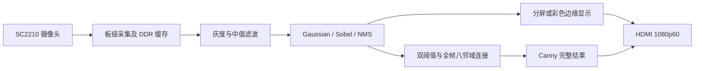

# F14 FPGA Vision

基于易灵思 **VF-Ti60F225** 与 **SC2210** 的全高清实时视觉处理项目。F14 在保留 F13 功能的基础上增加全帧 Canny 边缘连接。

> 本仓库公开项目自有算法、控制模块、仿真和说明。易灵思 IP、板卡示例、板级顶层衍生文件及字体资源作为外部依赖，不在本仓库重新分发。因此，单独克隆本仓库不能立即生成可烧录固件。

## 功能

|功能|实现内容|
|---|---|
|视频处理|1920×1080；加权灰度、默认中值滤波、Gaussian 平滑、Sobel 梯度和边缘细化|
|显示|灰度/边缘分屏、彩色画面青色边缘叠加、状态 OSD|
|交互|阈值调节、帧冻结、历史帧前后选择及回放|
|图形识别|白纸上的黑色实心圆形、正方形、三角形、梯形、五边形、六边形；彩色轮廓与中文名称|
|Canny|双阈值分类后进行全帧八邻域滞后连接，迭代至收敛；H 键切换|

HDMI 输出保持 1080p60。Canny 处理较慢时跳过新的采样帧，显示上一次完整结果；**HDMI 的 60 Hz 不等于 Canny 新结果帧率**。Canny 更新速度随连通结构、迭代次数及 DDR 竞争变化。

## 处理流程



## 目录

- `src/isp/`：灰度、去噪、边缘处理、图形识别、中文 OSD 和按键控制。
- `src/canny/`：Canny 连通引擎、跨时钟 FIFO、DDR 仲裁和显示状态。
- `src/axi/ddr_frame_store.v`：64 帧 RAW8 缓存及冻结/回放控制。
- `sim/`：测试平台、参考模型、测试向量生成器。
- `dependencies/`：外部依赖的相对路径、SHA-256 和本项目局部修改记录。
- `tools/restore_dependencies.py`：从合法取得的本地工程恢复依赖并逐一校验。

## 构建依赖

硬件目标为 Ti60F225，原完整工程使用 Efinity **2024.1**。厂商基础工程来自 SC2210 开发包中的 `FPGA-Ti60F225/04-1_Ti60_SC2210_HDMI_1080P60`。请通过板卡供应商及易灵思官方渠道获取工具、IP 和开发资料，并遵守它们的许可条款。

如果已有完整 F14 工程，可以在仓库根目录执行：

```powershell
python tools/restore_dependencies.py --f14-root "D:\path\to\SC2210_HDMI_1080P60_CANNY_F14"
```

校验通过后，在 Efinity 中打开恢复的 `Canny_F14.xml`。原始 `Ti60_Demo.xml` 不是 F14 的构建入口。

只持有厂商基础工程时，可使用 `--vendor-root` 检查可补齐的依赖；脚本会明确列出尚缺的 F14 集成顶层、工程配置、板级接口配置和中文字模。**这些文件不能由厂商基础包自动完整重建**，需要已有 F14 集成工程或自行完成板级集成。脚本缺少依赖时不写入任何文件，且不会覆盖不同内容的本地文件。

## 仿真

安装 Python 3、Icarus Verilog，以及 `requirements.txt` 列出的 NumPy、Pillow。将 Icarus 加入 PATH，或设置 `IVERILOG_BIN` 为其 bin 目录。

```powershell
python sim/run_canny_tests.py
# 较耗时的 1920×1080 测试：
python sim/run_canny_tests.py --full
```

Canny 默认测试独立于厂商 IP。共用图像前端、完整板级工程和部分历史测试仍需要外部依赖。重新生成中文字模前，需将 `F14_FONT` 指向自行取得且有权使用的中文字体；仓库不附带字体及其栅格化字库。

## 已有验证结果

以下数据来自原完整 F14 工程的 RTL 仿真及 Efinity 构建，不是对任意光照、镜头距离或场景的性能保证：

- 全高清系统仿真逐一核对 **2,073,600** 个像素，无 FIFO/DDR 错误。
- 一组系统用例连接计算为 **15,920,490 个 96 MHz 周期**，约 **165.84 ms**，正反扫描共 4 次；这个数值不包括全部采样和发布等待，不能直接换算为实物帧率。
- 资源：LUT4 41,269；FF 19,451；片上 RAM 255/256；XLR 55,924/60,800。
- 原构建常规时序最小 setup/hold 裕量为 0.002/0.026 ns；setup 裕量较小，移植或更改设置后必须重新进行时序与板级验证。
- 更多资源摘要见 [`docs/validation.json`](docs/validation.json)。

## 使用提示

A 切换显示；B 冻结；C 回放；D 实时；E/F 在冻结时前后选帧；G 图形识别；H Canny。普通模式沿用 F13 OSD，H 模式显示 F14 CANNY。

H 是新增外接常开按键，接 P4-16 与 P4-30（GND）。**先断开 H 烧录 F14，再完全断电接线。** 原 F13 将该信号用作输出，回退旧版前先断开 H。接线必须核对具体板卡版本和原理图。

## 许可和范围

项目自有源码与文档按 [MIT License](LICENSE) 发布。第三方 IP、板卡代码和字体不因本项目而获得新的许可；详见 [THIRD_PARTY.md](THIRD_PARTY.md)。编译缓存、下载器、开发工具许可证、完整位流以及含厂商代码的完整工程压缩包不上传。
